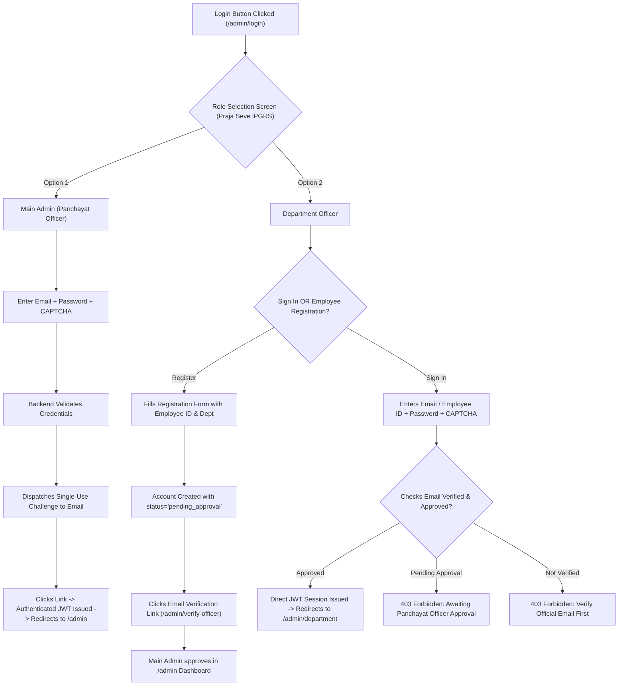

# GramSeva Two-Role Authentication System Documentation
**Inspired by the Karnataka Praja Seve (iPGRS) Portal**

---

## 1. Executive Summary

GramSeva has been upgraded from a single-admin login into a **Two-Role Authentication & Access Control System** adhering to Karnataka government administrative standards (Praja Seve iPGRS).

### The Two User Roles:
1. **Main Admin (Panchayat Officer)**:
   - Central administrative authority over Harohalli Gram Panchayat.
   - Unrestricted supervision across all 5 departments.
   - Sole authority to authorize, approve, or suspend Department Officers.
   - Protected by mandatory 2-stage authentication (Password + single-use email challenge link).
2. **Department Officer (Multi-Department Redressal)**:
   - Officers dedicated to specific departments: Sanitation (`SAN`), Public Works (`PWD`), Water Supply (`WTR`), Electricity (`ELE`), and General Administration (`ADM`).
   - Self-service employee registration (`Full Name`, `Employee ID`, `Official Email`, `Department`, `Password`).
   - Two-step authorization: **Official Email Verification** followed by **Main Admin (Panchayat Officer) Approval**.
   - Department-isolated dashboard with real-time metrics, status updates, resolution remarks, and proof attachments.

---

## 2. System Architecture & Authentication Flow

---

## 3. Database Schema & Migration Guide

The migration script is stored in:
- [database/05_three_role_auth_system.sql](file:///c:/Users/Tanisha/Desktop/TANISHA/GramSeva/database/05_three_role_auth_system.sql)
- [supabase/migrations/20261113000005_three_role_auth_system.sql](file:///c:/Users/Tanisha/Desktop/TANISHA/GramSeva/supabase/migrations/20261113000005_three_role_auth_system.sql)

### Summary of Schema Updates:
1. **Departments Table (`public.departments`)**:
   - `SAN` - Sanitation (`d0000001-0000-0000-0000-000000000001`)
   - `PWD` - Public Works (`d0000002-0000-0000-0000-000000000002`)
   - `WTR` - Water Supply (`d0000003-0000-0000-0000-000000000003`)
   - `ELE` - Electricity (`d0000004-0000-0000-0000-000000000004`)
   - `ADM` - General Administration (`d0000005-0000-0000-0000-000000000005`)
2. **Admin Memberships Table (`public.admin_memberships`)**:
   - Added `employee_id TEXT UNIQUE`
   - Added `department_code TEXT`
   - Added `is_email_verified BOOLEAN DEFAULT TRUE`
   - Added `email_verification_token_hash TEXT`
   - Added `approved_by TEXT`
   - Added `approved_at TIMESTAMPTZ`
   - Updated role check constraint: `role IN ('main_admin', 'primary_admin', 'department_officer', 'admin')`
   - Updated status check constraint: `status IN ('active', 'pending_approval', 'suspended', 'rejected')`

### How to Execute in Supabase:
1. Open the [Supabase SQL Editor](https://supabase.com/dashboard/project/pwvnotapsqdszbfgdgxe/sql).
2. Copy the contents of `database/05_three_role_auth_system.sql`.
3. Paste and click **Run**. It is completely idempotent and safe to run.

---

## 4. Pre-Configured Test Accounts

| Role | Name | Identifier (Email or Employee ID) | Default Password | Department |
|---|---|---|---|---|
| **Main Admin** | Panchayat Development Officer | `moollyatanisha@gmail.com` | `AdminGramSeva#2026!` | All Departments |
| **Dept Officer** | Sanitation Officer | `SAN-OFF-001` or `sanitation.officer@gramseva.gov.in` | `OfficerSAN#2026` | Sanitation (`SAN`) |
| **Dept Officer** | PWD Engineer | `PWD-OFF-002` or `pwd.officer@gramseva.gov.in` | `OfficerPWD#2026` | Public Works (`PWD`) |
| **Dept Officer** | Water Supply Supervisor | `WTR-OFF-003` or `water.officer@gramseva.gov.in` | `OfficerWTR#2026` | Water Supply (`WTR`) |
| **Dept Officer** | Electricity Lineman Lead | `ELE-OFF-004` or `electricity.officer@gramseva.gov.in` | `OfficerELE#2026` | Electricity (`ELE`) |
| **Dept Officer** | Panchayat Admin Officer | `ADM-OFF-005` or `admin.officer@gramseva.gov.in` | `OfficerADM#2026` | General Admin (`ADM`) |

---

## 5. Frontend Routes & Interface Guide

### 1. Role Selection & Login (`/admin/login`)
- **Initial View**: Two Karnataka Praja Seve iPGRS cards (**Main Admin** and **Department Officer**).
- **Security CAPTCHA**: High-contrast government verification code with single-click refresh button.
- **Main Admin View**: Email + Password + CAPTCHA -> Dispatches 2-stage verification challenge to email -> redirects to `/admin/verify-login`.
- **Department Officer View**:
  - **Sign In Tab**: Supports Email or unique Employee ID (e.g. `SAN-OFF-001`). Direct authenticated session on verification & approval -> redirects to `/admin/department`.
  - **Employee Registration Tab**: Full Name, unique Employee ID, Official Email, Department dropdown (`SAN`, `PWD`, `WTR`, `ELE`, `ADM`), Password.

### 2. Officer Email Verification (`/admin/verify-officer?token=...`)
- Validates the token sent via email.
- Displays confirmation that official email is verified and profile is now awaiting Main Admin approval.
- One-click button to return to login.

### 3. Department Officer Dashboard (`/admin/department`)
- **Department Badge**: Prominently displays department name and code (e.g., `Sanitation [SAN]`).
- **Data Isolation**: Strictly loads grievances assigned to that department.
- **Department Metrics**: Total, Pending/New, In Progress, and Resolved counts.
- **Resolution Drawer**: Allows officers to update status (`In Progress`, `Resolved`, `Rejected`), enter departmental resolution remarks, attach proof URL, and dispatch WhatsApp alerts to citizens.

### 4. Main Admin Central CRM (`/admin`)
- Full access across all 5 departments.
- **"Department Officers" Tab**:
  - Filter officers by department or status (`pending_approval`, `active`, `suspended`).
  - View Employee ID, email verification status, and approval info.
  - **1-Click "Approve Access"** to immediately activate pending officer registrations.
  - **"Suspend" / "Reactivate"** toggles to manage officer access.
- Auto-redirects any Department Officer who visits `/admin` directly to `/admin/department`.

---

## 6. Backend API Reference

| Endpoint | Method | Role Required | Description |
|---|---|---|---|
| `/api/auth/captcha` | `GET` | Public | Generates fresh 5-character government CAPTCHA with SVG image |
| `/api/auth/login` | `POST` | Public | Role-aware login for Main Admin (2-stage) & Department Officer (direct JWT) |
| `/api/auth/register-officer` | `POST` | Public | Department Officer self-registration with email verification link |
| `/api/auth/verify-officer-email` | `GET` | Public | Consumes email token and marks email as verified |
| `/api/auth/department-officers` | `GET` | Main Admin | Lists all registered department officers across departments |
| `/api/auth/department-officers/{id}/approve` | `POST` | Main Admin | Approves and activates a department officer account |
| `/api/auth/department-officers/{id}/deactivate` | `POST` | Main Admin | Suspends or reactivates an officer account |
| `/api/complaints` | `GET` | Authenticated | Filters complaints (enforces department isolation for officers) |
| `/api/complaints/{id}/status` | `PATCH` | Authenticated | Updates status, adds remarks, attaches proof URL |

---

## 7. Automated Test Verification Results

All unit tests and type checks pass completely:
- **Backend Unit Tests**: **19 passed** (`pytest -v backend/tests`).
  - `test_login_stage_a_success_issues_challenge_not_token` (PASSED)
  - `test_login_stage_a_invalid_password` (PASSED)
  - `test_login_stage_a_suspended_admin` (PASSED)
  - `test_login_stage_b_verification_success_issues_token` (PASSED)
  - `test_login_stage_b_replay_attack_rejected` (PASSED)
  - `test_login_stage_b_expired_token_rejected` (PASSED)
  - `test_invitation_workflow_and_rbac` (PASSED)
  - `test_primary_admin_cannot_suspend_self` (PASSED)
  - `test_password_reset_flow` (PASSED)
  - `test_captcha_generation` (PASSED)
  - `test_department_officer_registration_approval_and_login_flow` (PASSED)
  - AI classification tests (PASSED)
  - Complaints & analytics tests (PASSED)
  - WhatsApp webhook & simulator tests (PASSED)
- **Frontend Type Checking**: `npx tsc --noEmit` exited with code `0` (Zero TypeScript errors).
